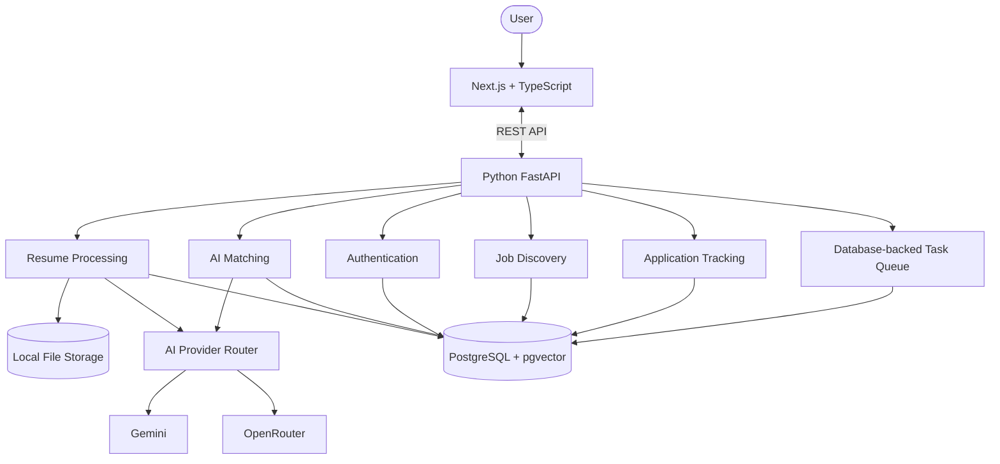
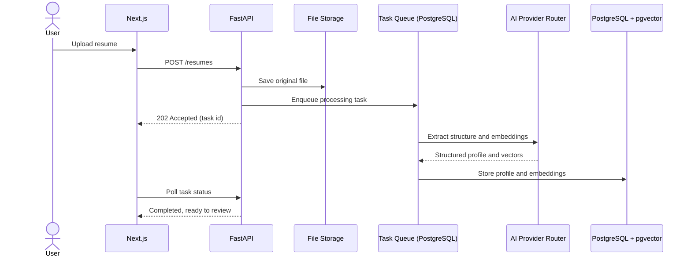

<h1 align="center">JobPilot AI</h1>

<p align="center">
  <strong>Your job search, on your own server.</strong><br>
  One profile. A tailored resume and cover letter for every job. Every application tracked from draft to offer.
</p>

<p align="center">
  
  
  
  
  
  
</p>

<!-- Add a screenshot or short screen recording here -->
<!--  -->

---

JobPilot AI is a self-hosted job search app. It keeps your career history in one profile, reads each job posting, shows how you match, and drafts a tailored resume and cover letter that **only use facts from your profile**. Every application is tracked from first draft to offer.

It is a copilot, not an autopilot. **Nothing is ever submitted without your explicit approval.**

## Contents

- [What it does](#what-it-does)
- [How it works](#how-it-works)
- [Human approval, always](#human-approval-always)
- [Architecture](#architecture)
- [Configuration](#configuration)
- [Choosing an AI provider](#choosing-an-ai-provider)
- [Choosing a job source](#choosing-a-job-source)
- [Backups and restore](#backups-and-restore)
- [Development](#development)
- [Project structure](#project-structure)
- [Roadmap](#roadmap)
- [Contributing](#contributing)
- [License](#license)

## What it does

| | |
| --- | --- |
| **One profile** | Contact details, skills, employment, projects, education, and publications live in a single profile. Upload an existing PDF or Word resume and JobPilot fills the profile in for you to review. |
| **Find jobs** | Search postings from your chosen job source, save or dismiss them, and start an application from any result. |
| **Understand the posting** | Paste a job posting. JobPilot extracts its requirements and compares each one with your profile. |
| **Honest matching** | Requirements you meet are linked to your evidence. Requirements you do not meet are shown as **gaps**, never papered over. |
| **Tailored documents** | A resume and cover letter for that job, written in the tone you pick and limited to what your profile actually says. |
| **Edit and regenerate** | Edit drafts by hand, regenerate sections, or revise individual parts such as the greeting and sign-off. |
| **Track every application** | Each application moves through a lifecycle from draft to offer, with notes and a history of changes. |
| **Your choice of AI** | Route requests to Gemini or OpenRouter, with automatic fallback if one provider fails. |
| **Browser-assisted form prep** *(planned)* | Pre-fill application forms, then stop and wait for your approval before anything is submitted. |

> AI output is probabilistic. Read every generated document before you send it.

## How it works

1. **Build your profile.** Upload a resume or fill it in by hand. The original file is stored on disk and the structured data goes to PostgreSQL.
2. **Find a job.** Search from inside the app, or paste a posting you found elsewhere.
3. **Read and match.** JobPilot extracts the requirements and ranks them against your profile using vector similarity (pgvector) plus LLM reasoning.
4. **Review the gaps.** See what you cover, what you partly cover, and what is missing.
5. **Draft.** Generate a tailored resume and cover letter grounded in your profile.
6. **Edit and approve.** Make changes, then explicitly approve the application.
7. **Track.** Follow the application through interviews to an offer, rejection, or withdrawal.

Slow work (parsing, embeddings, matching, job discovery) runs in the background through a task queue stored in PostgreSQL, so there is no Redis or message broker to run.


## Architecture



| Component | Role |
| --- | --- |
| **Next.js + TypeScript** | The web interface. It only talks to the FastAPI backend, never to the database or AI providers. |
| **Python FastAPI** | The REST API. Owns authentication, validation, and orchestration of every module below. |
| **Resume Processing** | Accepts uploads, extracts text, structures the profile with an LLM, stores the original file, and writes embeddings. |
| **AI Matching** | Finds similar jobs and profile facts with pgvector, then asks an LLM to explain fit, requirements, and gaps. |
| **Authentication** | Sign-up, login, and per-user data isolation. |
| **Job Discovery** | Collects postings from the configured source, normalizes and de-duplicates them, and stores them with embeddings. |
| **Application Tracking** | Stores applications, their lifecycle state, notes, and history. |
| **Database-backed Task Queue** | Persists background tasks in PostgreSQL and runs them in a worker with retries and status reporting. |
| **AI Provider Router** | One interface in front of Gemini and OpenRouter, with configurable routing and fallback. |
| **PostgreSQL + pgvector** | The single system of record: users, profiles, jobs, embeddings, applications, and the task queue. |
| **Local File Storage** | Original resumes and generated documents on disk (`/data`). |

### Resume upload flow




### Requirements

- Docker with the Compose plugin
- About 2 GB of free memory
- An API key for Gemini and/or OpenRouter (or see [Choosing an AI provider](#choosing-an-ai-provider))
- A domain with HTTPS in front, if you run it on a server

### 1. Get the code

```bash
git clone https://github.com/<your-username>/jobpilot-ai.git
cd jobpilot-ai
cp .env.example .env
```

### 2. Fill in `.env`

At minimum, set these:

```env
POSTGRES_PASSWORD=choose-a-strong-password
JOBPILOT_SECRET=at-least-32-random-characters
GEMINI_API_KEY=your-key        # and/or OPENROUTER_API_KEY
```

Generate a secret with:

```bash
openssl rand -hex 32
```

### 3. Start it

```bash
docker compose up -d
```

Then open <http://localhost:3000>, create your account, and upload your resume.

### Example `docker-compose.yml`

```yaml
services:
  db:
    image: pgvector/pgvector:pg16
    restart: unless-stopped
    environment:
      POSTGRES_USER: jobpilot
      POSTGRES_PASSWORD: ${POSTGRES_PASSWORD:?}
      POSTGRES_DB: jobpilot
    volumes:
      - pgdata:/var/lib/postgresql/data
    healthcheck:
      test: ["CMD-SHELL", "pg_isready -U jobpilot -d jobpilot"]
      interval: 5s
      timeout: 5s
      retries: 10

  api:
    build: ./backend
    restart: unless-stopped
    depends_on:
      db:
        condition: service_healthy
    env_file: .env
    environment:
      DATABASE_URL: postgresql+psycopg://jobpilot:${POSTGRES_PASSWORD}@db:5432/jobpilot
      FILE_STORAGE_PATH: /data
    volumes:
      - data:/data
    ports:
      - "127.0.0.1:8000:8000"

  worker:
    build: ./backend
    restart: unless-stopped
    command: python -m app.tasks.worker
    depends_on:
      db:
        condition: service_healthy
    env_file: .env
    environment:
      DATABASE_URL: postgresql+psycopg://jobpilot:${POSTGRES_PASSWORD}@db:5432/jobpilot
      FILE_STORAGE_PATH: /data
    volumes:
      - data:/data

  web:
    build: ./frontend
    restart: unless-stopped
    depends_on:
      - api
    environment:
      NEXT_PUBLIC_API_URL: http://localhost:8000
    ports:
      - "127.0.0.1:3000:3000"

volumes:
  pgdata:
  data:
```

> Keep ports `3000` and `8000` bound to `127.0.0.1` and put a reverse proxy such as Caddy or Nginx with HTTPS in front when you run on a server.

## Configuration

Everything is set through environment variables.

### Required

| Variable | What it does |
| --- | --- |
| `DATABASE_URL` | PostgreSQL connection string. With Compose it is built from `POSTGRES_PASSWORD`. |
| `JOBPILOT_SECRET` | Secret used to sign sessions and tokens. 32 or more random characters. |
| `GEMINI_API_KEY` or `OPENROUTER_API_KEY` | At least one AI provider key. |

### Optional

| Variable | Default | What it does |
| --- | --- | --- |
| `FILE_STORAGE_PATH` | `./storage` | Where resumes and generated documents are stored. Use a volume. |
| `AI_PRIMARY_PROVIDER` | `gemini` | Provider tried first (`gemini` or `openrouter`). |
| `AI_FALLBACK_PROVIDER` | `openrouter` | Provider used if the primary fails or is rate limited. |
| `AI_TEXT_MODEL` | provider default | Model used for drafting and reasoning. |
| `AI_EMBEDDING_MODEL` | provider default | Model used for embeddings. |
| `AI_TIMEOUT_SECONDS` | `120` | Time to wait for an AI response. |
| `JOBS_SOURCE` | none | Job source to search (see [Choosing a job source](#choosing-a-job-source)). |
| `JOBS_API_KEY` | none | Key for the chosen job source, if it needs one. |
| `WORKER_CONCURRENCY` | `2` | Number of background tasks run at once. |
| `BACKUP_RETENTION_DAYS` | `14` | How long nightly backups are kept. |
| `CORS_ORIGINS` | `http://localhost:3000` | Allowed web origins for the API. |
| `NEXT_PUBLIC_API_URL` | `http://localhost:8000` | API address the web app calls. |
| `TZ` | `UTC` | Time zone for schedules and timestamps. |

> Never commit `.env`. Only `.env.example` belongs in the repository.

## AI provider

JobPilot AI sends every AI request through the **AI Provider Router**, so no other module depends on a specific vendor.

| Provider | Good for | Notes |
| --- | --- | --- |
| **Gemini** | A direct, simple setup with one API key. | Your profile and job text are sent to Google. |
| **OpenRouter** | One key that reaches many hosted models, and a good fallback. | Data goes to OpenRouter and the model provider behind it. |

Set a primary and a fallback, for example:

```env
AI_PRIMARY_PROVIDER=gemini
AI_FALLBACK_PROVIDER=openrouter
```

If the primary provider errors or is rate limited, the router retries on the fallback so a draft does not fail halfway.

## Choosing a job source

Job Discovery pulls postings from one configured source and stores them with embeddings so they can be matched against your profile.

```env
JOBS_SOURCE=your-source-name
JOBS_API_KEY=your-key
```

You can also skip search entirely: paste any posting into **New application** and JobPilot reads it the same way.

> Supported sources are listed in `docs/job-sources.md` once implemented.

## Backups and restore

Everything that matters is in two places: the PostgreSQL database and the `/data` folder.

**Back up**

```bash
docker compose exec db pg_dump -U jobpilot -Fc jobpilot > jobpilot.dump
docker cp "$(docker compose ps -q api)":/data ./data-backup
```

**Restore**

```bash
docker compose stop api worker web
docker compose exec -T db pg_restore --clean --if-exists -U jobpilot -d jobpilot < jobpilot.dump
docker compose start api worker web
```

Test a restore before you rely on it.

## Upgrading

1. Take a [backup](#backups-and-restore).
2. Pull the new version and rebuild:

   ```bash
   git pull
   docker compose build
   docker compose up -d
   ```

3. Database migrations run on startup. Read the release notes first if a release mentions configuration changes.

Pin a tagged release instead of `main` if you want to upgrade only when you choose.

## Privacy: what leaves your server

Self-hosting keeps the app, your database, and your files on your own machine. Some data still goes out when you use external services:

| Feature | What is sent | To whom |
| --- | --- | --- |
| Resume parsing and drafting | Your profile text and job posting text | Your chosen AI provider (Gemini or OpenRouter) |
| Embeddings | Profile and posting text | Your chosen AI provider |
| Job search | Your search terms | Your chosen job source |

Nothing else leaves your server. Read each provider's data policy before sending sensitive career details.


## Development

### Prerequisites

- Node.js 20+
- Python 3.11+
- PostgreSQL 15+ with the [`pgvector`](https://github.com/pgvector/pgvector) extension

### Run it locally

```bash
# 1. Database
docker run -d --name jobpilot-db \
  -e POSTGRES_USER=jobpilot -e POSTGRES_PASSWORD=jobpilot -e POSTGRES_DB=jobpilot \
  -p 5432:5432 pgvector/pgvector:pg16

# 2. Backend
cd backend
python -m venv .venv && source .venv/bin/activate
pip install -r requirements.txt
alembic upgrade head
uvicorn app.main:app --reload --port 8000

# 3. Worker (new terminal)
cd backend && source .venv/bin/activate
python -m app.tasks.worker

# 4. Frontend (new terminal)
cd frontend
npm install
npm run dev
```

Open <http://localhost:3000>. Interactive API docs are at <http://localhost:8000/docs>.

### Tests

```bash
cd backend && pytest
cd frontend && npm test
```

### API overview

> Illustrative routes. Update to match the implementation.

| Area | Route | Purpose |
| --- | --- | --- |
| Auth | `POST /auth/register`, `POST /auth/login` | Create an account and sign in |
| Profile | `GET/PUT /profile` | Read and edit your single profile |
| Resume | `POST /resumes` | Upload a resume (queues processing) |
| Jobs | `GET /jobs`, `GET /jobs/{id}` | Search and view postings |
| Matching | `GET /jobs/{id}/match` | Requirements, evidence, and gaps |
| Documents | `POST /applications/{id}/documents` | Generate a resume and cover letter |
| Applications | `GET/POST /applications`, `PATCH /applications/{id}` | Track lifecycle, notes, and status |
| Approval | `POST /applications/{id}/approve` | Explicit approval before any submission |
| Tasks | `GET /tasks/{id}` | Background task status |

## Project structure

```
jobpilot-ai/
├── frontend/                # Next.js + TypeScript app
├── backend/
│   ├── app/
│   │   ├── main.py          # FastAPI entrypoint
│   │   ├── core/            # Config, security, database session
│   │   ├── auth/            # Authentication
│   │   ├── resumes/         # Resume Processing
│   │   ├── matching/        # AI Matching
│   │   ├── jobs/            # Job Discovery
│   │   ├── applications/    # Application Tracking
│   │   ├── tasks/           # Database-backed Task Queue and worker
│   │   ├── ai/              # AI Provider Router (Gemini, OpenRouter)
│   │   └── storage/         # Local File Storage
│   ├── migrations/
│   └── tests/
├── docs/                    # Extra documentation and images
├── docker-compose.yml
├── .env.example
└── README.md
```


## Roadmap

- [x] Architecture design
- [ ] Authentication
- [ ] Resume upload, parsing, and structured profile
- [ ] Embeddings and vector search with pgvector
- [ ] AI Provider Router with fallback (Gemini, OpenRouter)
- [ ] Database-backed task queue and worker
- [ ] Job discovery and ingestion
- [ ] AI matching with requirements, evidence, and gaps
- [ ] Tailored resume and cover letter generation, with editing and regeneration
- [ ] PDF export and resume themes
- [ ] Application tracking from draft to offer
- [ ] Browser-assisted form preparation with mandatory human approval
- [ ] Local model support (for example Ollama)
- [ ] Cloud object storage option
- [ ] Automated tests and CI

## Contributing

Contributions are welcome.

1. Fork the repository and create a branch: `git checkout -b feature/your-feature`.
2. Make your change and add tests where it makes sense.
3. Open a pull request that explains what changed and why.

Any feature that touches application submission must keep the explicit human approval step intact.

## License

See [`LICENSE`](LICENSE).
